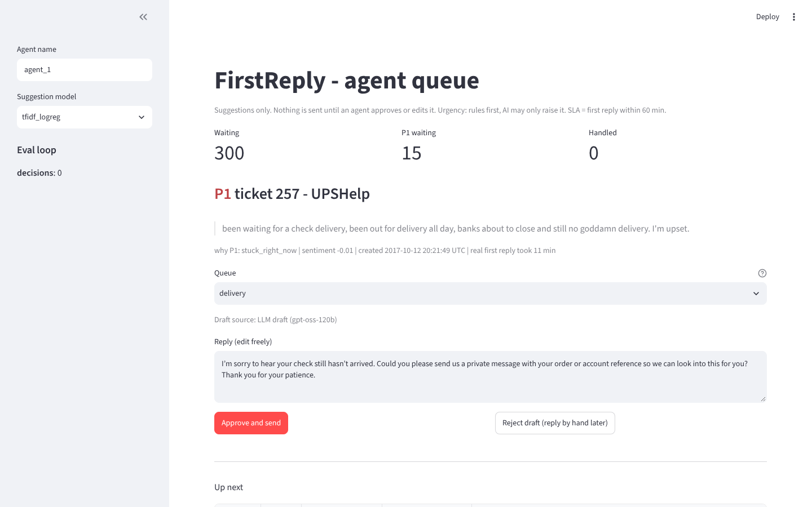
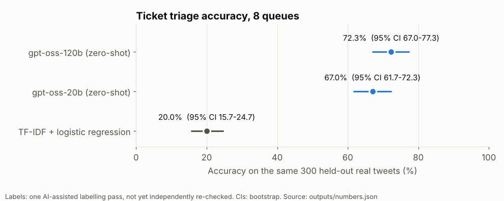
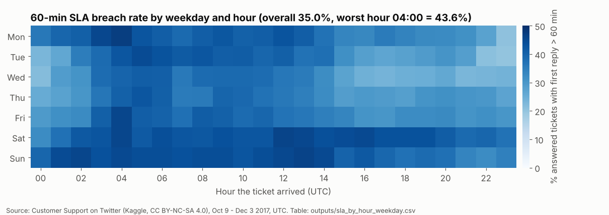
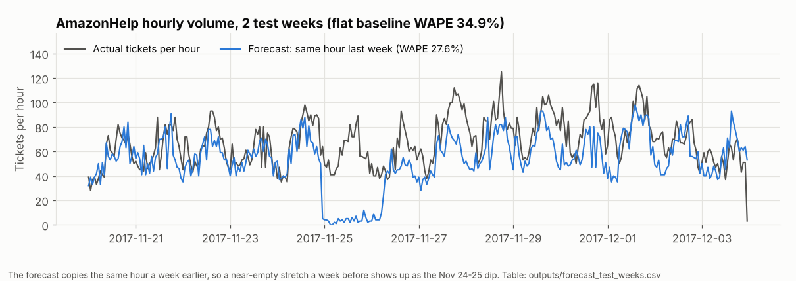
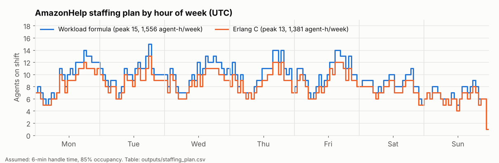
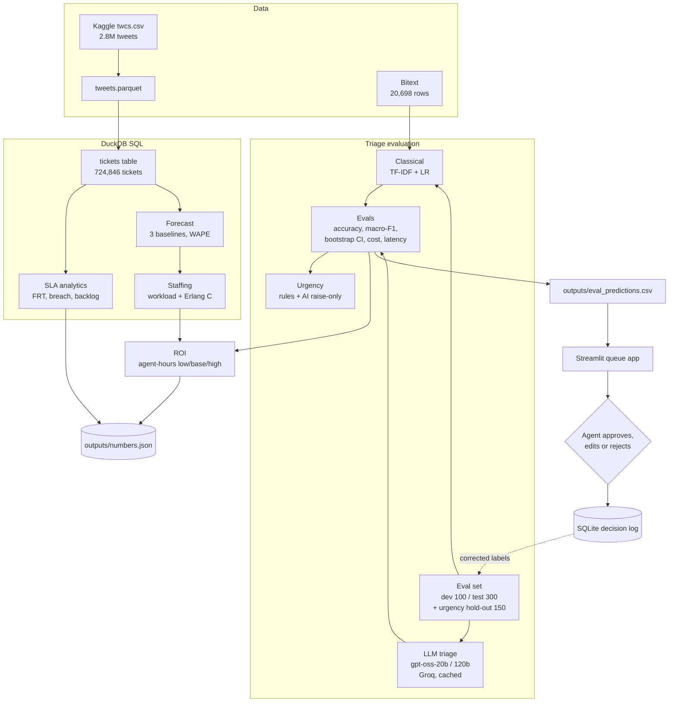
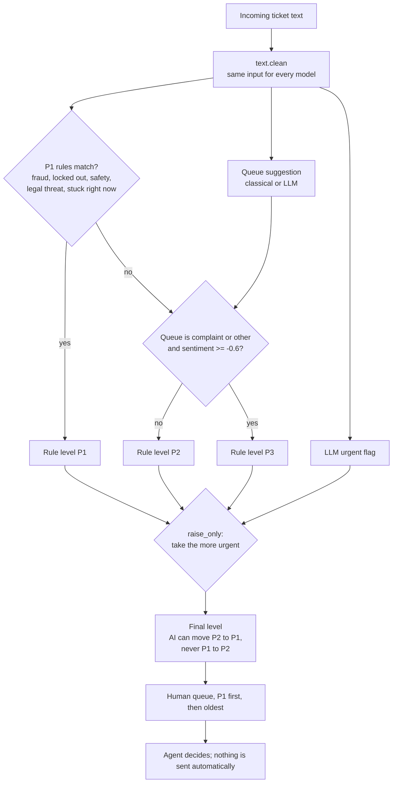
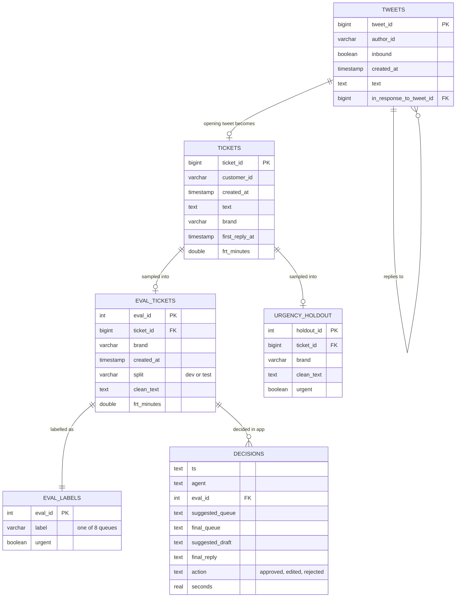
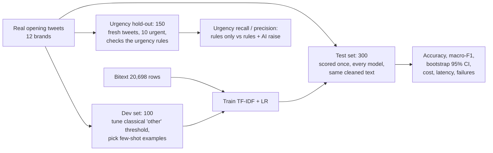
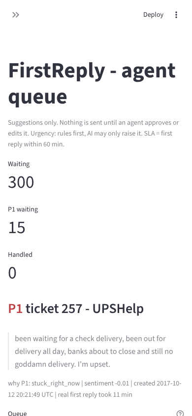

# FirstReply

[](https://github.com/Zakuroooo/firstreply/actions/workflows/ci.yml)

[](https://creativecommons.org/licenses/by-nc-sa/4.0/)
[](https://cdla.dev/sharing-1-0/)

**Support operations analytics on 724,846 real support tickets, plus an honest test of AI ticket triage.**
It measures how fast 108 brands first replied on Twitter, forecasts volume and staffing, compares a classical
classifier with two LLMs on the same 300 real tweets (accuracy, cost, latency), keeps a human approving every
reply, and turns the result into an ROI memo a support leader can act on.

- **Real timestamps**: 724,846 tickets (Twitter, Oct 9 - Dec 3 2017) give first-response time, SLA breach
  rate, backlog, forecast and staffing.
- **Same exam for every model**: 300 labelled real tweets; TF-IDF + logistic regression vs two LLMs.
- **Urgency**: rules decide P1, the AI may only **raise** urgency, never lower it.
- **Agent queue app**: urgent first, suggested queue + draft, approve / edit / reject, every decision logged.
- **Consulting memo**: process map, staffing, ROI in agent-hours with ranges, rollout plan, risks:
  [docs/MEMO.md](docs/MEMO.md).

**Live demo**: not deployed yet, see [docs/RUNBOOK.md](docs/RUNBOOK.md) for the deploy steps.



## Findings
Every number comes from [`outputs/numbers.json`](outputs/numbers.json), rebuilt by `make all`.

| Question | Answer |
|---|---|
| How fast do brands first reply? | Median **23.7 min**, p90 **535.2 min** (~9 h) |
| How often is a 60-min SLA missed? | **35.0%** of answered tickets (58.6% at 15 min, 17.2% at 4 h) |
| When is it worst? | 04:00 UTC (43.6%) and weekends (Sat 42.1%) vs Wednesday 30.0% |
| Best forecast for staffing? | Same hour last week: WAPE **27.6%** vs 34.9% flat |
| Agents needed (AmazonHelp volume)? | 1,556 agent-hours/week, peak 15 agents (6-min handle time, 85% occupancy assumed) |
| Classical triage on tidy vs real text? | **99.9%** on Bitext -> **20.0%** on real tweets (CI 15.7-24.7) |
| LLM triage on the same 300 tweets? | 67.0% (20b) / **72.3%** (120b, CI 67.0-77.3) vs 20.0% classical |
| LLM cost and speed? | **$0.04-0.08 per 1,000 tickets**, ~0.6 s median |
| Urgency rules on fresh tweets? | Rules alone caught 3 of 10 urgent; with the AI allowed to raise urgency, **7 of 10** |
| Is routing worth it? | Break-even at 33.3% accuracy: classical loses ~21 h/week, LLM saves ~61 h/week (base) |

### Charts
Drawn from the committed `outputs/` tables by `python scripts/make_charts.py`.









## Architecture



More detail: [docs/ARCHITECTURE.md](docs/ARCHITECTURE.md).

### Triage and urgency flow
Missing an urgent ticket (fraud, locked out, safety) costs far more than reviewing a few extra, so the
deterministic rules set the floor and the model can only push a ticket up.



### Data model
DuckDB builds `tickets` from the tweets view (`sql/01_tickets.sql`); the eval set lives in CSV files; the
queue app writes one row per human decision to SQLite (`src/firstreply/hitl.py`).



### Evaluation design
Labels were fixed before any model was run; the test set was never used for tuning.



## Agent queue app
`make app` opens the queue on http://localhost:8501. It shows P1 tickets first, the reason for the level, the
suggested queue and a draft reply. The draft is an LLM draft when it is cached or a `GROQ_API_KEY` is set, and
a labelled template otherwise. Every approve / edit / reject goes to the SQLite log, and the sidebar shows the
eval loop: share approved unchanged, edited, rejected, queue kept.

Screenshots were taken from the app running headless in a container with no API key; the draft shown is a
real cached gpt-oss-120b response.



## Tech stack

| Part | Tool | Why |
|---|---|---|
| Data | Kaggle "Customer Support on Twitter" (twcs), Bitext customer-support dataset, Parquet via DuckDB | Real timestamps for SLA work; Bitext is the tidy labelled set a classical model can train on; Parquet keeps the 500 MB CSV out of pandas memory |
| SQL / analytics | DuckDB, pandas | Plain SQL over 2.8M rows on a laptop or CI runner with a 3 GB cap; no server to run |
| Forecasting / staffing | Seasonal-naive and averaging baselines (WAPE), workload formula and Erlang C | Simple baselines a support team can check by hand; Erlang C is the standard contact-centre staffing model |
| Classical ML | scikit-learn TF-IDF + logistic regression | Cheap, fast (well under 1 ms per ticket), a fair baseline to beat |
| LLM | Groq API, gpt-oss-20b and gpt-oss-120b, on-disk response cache | Low cost per call; the cache makes every LLM number reproducible without a key |
| Evaluation / statistics | Accuracy, macro-F1, bootstrap 95% CIs, VADER sentiment, regex urgency rules | Intervals show which differences are real (120b vs 20b is not); rules keep urgency predictable and testable |
| App | Streamlit, SQLite decision log | A working human-approval queue in one file; SQLite needs no setup and is easy to swap for Postgres |
| Tests / CI | pytest (60 tests), GitHub Actions, Docker | Tests run without the data; a manual Actions job rebuilds every number from raw data |

## Project structure
```
firstreply/
├── app/queue_app.py        Streamlit agent queue
├── sql/                    DuckDB SQL: tickets, FRT by brand / hour, backlog, hourly volume
├── src/firstreply/         analytics, staffing, classical model, LLM client, evals, urgency, HITL queue, ROI
├── scripts/                download + verify data, build eval sets, warm LLM cache, label re-check, charts
├── evalset/                400 labelled tweets (100 dev / 300 test), 150-tweet urgency hold-out, re-check sheet
├── outputs/                generated tables, numbers.json, llm_cache/ with real cached LLM calls
├── tests/                  60 unit tests, no data needed
├── docs/                   PRD, architecture, evals, decisions, memo, data, runbook, images/
├── LEARN/                  every concept from zero + 25 interview questions
├── Makefile  Dockerfile  requirements.txt  .github/workflows/ci.yml
```
Docs: [PRD](docs/PRD.md), [ARCHITECTURE](docs/ARCHITECTURE.md), [EVALS](docs/EVALS.md),
[DECISIONS](docs/DECISIONS.md), [MEMO](docs/MEMO.md), [DATA](docs/DATA.md), [RUNBOOK](docs/RUNBOOK.md).

## Run it
```bash
python -m venv .venv && source .venv/bin/activate
pip install -r requirements.txt
make test     # 60 tests, no data needed
make evals    # classical vs LLM triage; downloads Bitext (~20 MB), LLM rows come from outputs/llm_cache/
make all      # download + verify data (~540 MB), SLA analytics, evals, ROI -> outputs/
make app      # agent queue on http://localhost:8501
```
- New LLM calls need `GROQ_API_KEY` in `.env` (git-ignored) or the environment. Cached calls need no key.
- Charts: `pip install matplotlib && python scripts/make_charts.py` (reads only committed `outputs/`).
- No laptop? GitHub **Actions -> ci -> Run workflow** runs `make all` and commits `outputs/`.
- Docker: `docker build -t firstreply . && docker run -p 8501:8501 firstreply`.

## Limitations
Read these before quoting any number.

- **Labels are not independently checked.** The 400 eval tweets and the 150 hold-out tweets were labelled in
  one AI-assisted session following [docs/LABEL-GUIDE.md](docs/LABEL-GUIDE.md), not by an independent human
  labeller. There is no inter-annotator agreement score yet. A blind 50-tweet human re-check is prepared
  (`evalset/recheck_50.csv`, scored with `python scripts/recheck.py score`) but not done. Until it is, treat
  every accuracy figure as "agreement with one labelling pass".
- **Urgent samples are tiny.** The hold-out has 10 urgent tweets out of 150 and the test set has 16 out of
  300. "3 of 10 -> 7 of 10" is a direction, not a precise recall; one tweet moves it by 10 points.
- **Small classes.** order_change has 5 test tickets and talk_to_human 11; their per-class scores are noise.
- **120b vs 20b is not separable**: the 95% intervals overlap.
- **Old, single-channel data**: Twitter only, 2017, UTC. The 60-minute SLA, 6-minute handle time and 85%
  occupancy are assumptions.
- **ROI drafting savings are assumptions** with a wide low/base/high range until a pilot measures them.
- **Not deployed**: the app has only been run locally and in a container.
- **Licences**: the Twitter dataset is CC BY-NC-SA 4.0 (non-commercial); Bitext is CDLA-Sharing 1.0. This is a
  portfolio project, not a commercial product.
