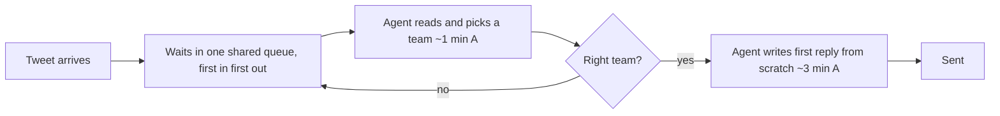
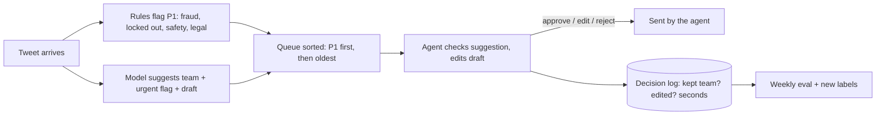

# Memo: Should a social-support team switch on AI triage?

**To**: Head of Customer Support (illustrative client: a team handling AmazonHelp's ticket volume)
**From**: Pranay Sarkar
**Data**: 724,846 real support tickets to 108 brands on Twitter, 9 Oct - 3 Dec 2017; 300 hand-labelled test
tweets. All numbers from `outputs/numbers.json`; assumptions marked **[A]**.

## 1. Answer first
- **Do not** switch on the classical (keyword-style) router. On real tweets it is right 20% of the time, below
  the 33% break-even, so it would **cost** about 21 agent-hours a week instead of saving them.
- **Do** run a 6-week pilot of LLM-suggested queues + draft replies, with an agent approving every reply.
  Early evidence (interim, 154 tickets): 71% routing accuracy for ~$1 per week of model cost.
- Expected saving at base assumptions: **~60 agent-hours/week from routing** (≈1.5 FTE), plus **50-468 hours
  from drafts** - a wide range because draft usefulness is not measured yet. The pilot measures it.

## 2. Where the team is today (current state)
| Measure (SLA = first reply within 60 min [A]) | All brands | AmazonHelp |
|---|---|---|
| Median first-response time | 23.7 min | 10.4 min |
| p90 first-response time | 535.2 min (~9 h) | 31.3 min |
| Breach rate | 35.0% | 3.3% |

- The SLA choice matters: breach is 58.6% at a 15-minute target and 17.2% at 4 hours.
- Worst hour 04:00 UTC (43.6% breach) vs best 23:00 UTC (26.8%). Weekends are worst: Saturday 42.1%,
  Sunday 40.9% vs Wednesday 30.0%. Staffing does not follow demand.
- Backlog of unanswered tickets: median 2,140 across brands, peak 3,856.
- Brands differ hugely: TMobileHelp median 2.6 min, AskPayPal 1,207.5 min (93.3% breach).

AmazonHelp already meets the SLA, so for a team like it the case is **efficiency** (same SLA with fewer
hours). For a team like AskPayPal or AppleSupport (57.2% breach) the same hours would buy **speed**.

## 3. Staffing from the volume data
- Forecast: "same hour last week" (seasonal naive) had the lowest error: WAPE 27.6% vs 34.9% for a flat plan.
- Next week for AmazonHelp: 12,540 tickets, 74.6 per hour on average, peak 125 per hour (Tuesday 18:00 UTC).
- At 6 min handle time [A] and 85% occupancy [A]: **1,556 agent-hours/week**, peak 15 agents (workload method);
  Erlang C for 90% within 60 min: 1,381 hours, peak 13 agents. Plan per hour: `outputs/staffing_plan.csv`.

## 4. Process map
**Current**

**Future (pilot)**

Rule: the model may make a ticket **more** urgent, never less. Nothing is sent without an agent.

## 5. Options compared (same 300 / 154 real tickets)
| Option | Routing accuracy | Cost per 1,000 tickets | Latency | Verdict |
|---|---|---|---|---|
| A. Classical, trained on tidy public data | 20.0% (99.9% on its own tidy data) | ~$0 | <1 ms | Below break-even. Reject. |
| B. Small LLM (gpt-oss-20b) | 66.2% (interim) | $0.042 | ~0.5 s | Viable, cheapest |
| C. Large LLM (gpt-oss-120b) | 71.4% (interim) | $0.084 | ~0.6 s | Pilot default; B vs C not separable yet |
| D. Classical trained on our own labelled tickets | not tested | ~$0 | <1 ms | Re-test after pilot gives labels |

## 6. ROI in agent-hours (AmazonHelp volume, 12,540 tickets/week)
Per ticket: routing saves accuracy x 1.0 min [A] x 50% [A], minus (1 - accuracy) x 0.25 min [A] to fix a wrong
suggestion. Drafting saves 50% of tickets [A] x 3 min [A] x 60% [A]. All [A] values have low/high ranges in
`src/firstreply/roi.py`.

| Hours saved per week | Low | Base | High |
|---|---|---|---|
| Routing, classical (20.0%) | -77.3 | **-20.9** | 27.2 |
| Routing, large LLM (71.4%, interim) | -7.5 | **59.7** | 150.7 |
| Drafting (any model; not measured) | 50.2 | 188.1 | 468.2 |
| **Total, large LLM** | 42.7 | **247.8** | 618.9 |

- Base total = 15.9% of the 1,556 staffed hours. Model cost ≈ $1.06/week for triage (drafts not yet priced).
- Break-even routing accuracy = **33.3%**. Below it, suggestions waste time.
- Sensitivity (`outputs/roi_sensitivity.csv`): the biggest unknown is **how often a draft is used** (swing 150
  hours/week), then writing time per reply. Routing assumptions move the answer far less. So the pilot must
  measure draft usage and handle seconds first.
- In money: hours x loaded hourly cost of an agent in your market. Left to the client on purpose.

## 7. Rollout plan
| Phase | What | Go / stop rule |
|---|---|---|
| 0. Data (1 week) | 2 people label the same 200 recent tickets; measure agreement; finish full LLM eval | Agreement < 80% -> fix label rules first |
| 1. Shadow (2 weeks) | Model runs silently on live tickets; compare with agents' choices | Routing >= 60% and P1 recall >= rules-only, else stop |
| 2. Assist (4 weeks) | One queue, one shift sees suggestions + drafts; every decision logged | Handle seconds down vs control shift; no rise in complaints about replies |
| 3. Scale | Other queues and shifts; weekly eval from the log | Any weekly drop below the bar -> back to Phase 1 |

## 8. Risks and how they are handled
| Risk | Control |
|---|---|
| Wrong team suggested | Agent sees and changes it; "queue kept %" tracked weekly |
| Bad or made-up draft sent in a hurry | Draft rules (no promises, no passwords, no policies); agent must click; spot-check 5% |
| Urgent ticket missed | Rules decide P1; AI can only raise; P1 recall reported weekly on a fresh sample |
| Customer data sent to a model API | Mask handles and links (done); vendor data terms; or self-host an open-weight model |
| Agents trust it blindly | Show the reason for P1; track edit rate - 100% "approved unchanged" is a warning sign |
| Cost creep | Cost per 1,000 tickets logged per call; alert above budget |
| This analysis is wrong for your team | 2017 Twitter data, UTC times, assumed SLA and handle times: Phase 0-1 re-measure all of it on your data |

## 9. What would change my recommendation
- Full 300-ticket LLM accuracy below ~50% -> routing gains shrink toward zero; pilot drafts only.
- Pilot shows drafts used on < 30% of tickets -> drafting hours fall to the low case (~50 h/week).
- A classical model trained on the pilot's labels reaches LLM accuracy -> use it: same accuracy, near-zero cost.
